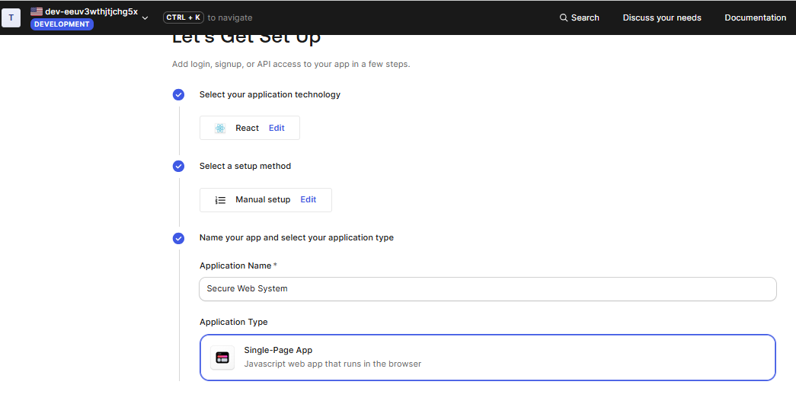
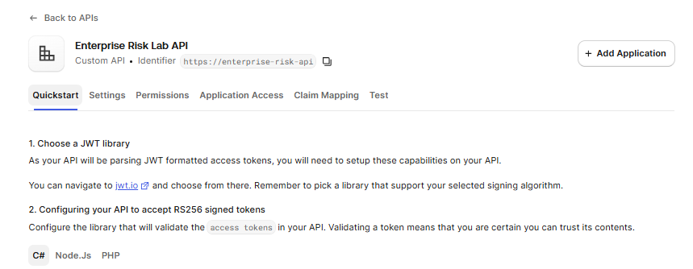
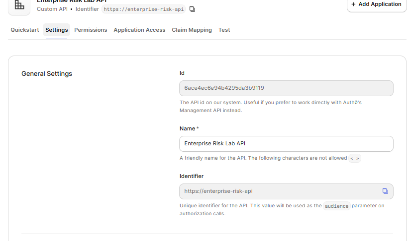
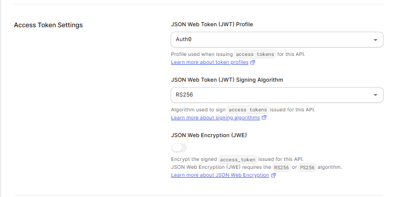

# TDSE Secure Web System
## Mariana Malagón

Enterprise risk control workshop: a small web system that demonstrates identity
management, authorization, and encryption in transit as security controls.

## Overview

- **Frontend**: React (Vite) single-page application, authenticates users via Auth0.
- **Backend**: Spring Boot API, acting as an OAuth 2.0 Resource Server that validates
  JWT access tokens issued by Auth0.
- **Deployment**: Ubuntu server (AWS EC2), Apache HTTP Server as reverse proxy and TLS
  terminator, public hostname via Duck DNS, certificate issued by Let's Encrypt.

The backend exposes a single protected endpoint, `GET /api/risk-status`. The frontend
logs the user in through Auth0, obtains an access token, and calls the endpoint with
`Authorization: Bearer <token>`.

## Architecture

### Authentication and request flow

```
Browser
   |
   | 1. Login redirect
   v
 Auth0 ------------------------------> React frontend
   |                                        |
   | 2. Access token (JWT)                  |
   <----------------------------------------+
                                             |
                                             | 3. GET /api/risk-status
                                             |    Authorization: Bearer <token>
                                             v
                                      Spring Boot API
                                (validates issuer + audience)
```

### Deployment layout

```
                    +------------------------------------------------+
                    |                  EC2 instance                   |
                    |                                                  |
                    |   +----------+   +----------+   +----------+     |
  User              |   |  Apache  |   |  React   |   |  Spring  |     |
   |                |   | (reverse |   |    FE    |   |    BE    |     |
   |  HTTPS         |   |  proxy)  |   | (static  |   | (:8080,  |     |
   +--------------->|   +----+-----+   |  build)  |   |  local   |     |
                    |        |         +----------+   |  only)   |     |
                    |        v                         +----------+     |
                    |   +----------+                                   |
                    |   | TLS cert |                                   |
                    |   | (Let's   |                                   |
                    |   | Encrypt) |                                   |
                    |   +----------+                                   |
                    +------------------------------------------------+
                             ^
                             |
                        Duck DNS
                (subdomain resolves to the EC2 public IP)
```

- Apache terminates TLS and reverse-proxies `/api/*` to the Spring Boot process.
- The Spring Boot process listens only on `127.0.0.1:8080`; it is never reachable
  from the public internet, only through Apache.
- Apache also serves the React production build (`dist/`) as static files.
- Both the React frontend and the Spring Boot API trust the same Auth0 tenant: the
  frontend for login and token retrieval, the backend for validating the token's
  issuer and audience.

## Deployed URL

_Pending deployment (Part 6)._

## Progress

- [x] Part 0 — Repository skeleton
- [x] Part 1 — Auth0 tenant, SPA application, API
- [ ] Part 2 — Spring Boot backend (local)
- [ ] Part 3 — React frontend (local)
- [ ] Part 4 — Server preparation and Duck DNS
- [ ] Part 5 — Backend deployment (systemd)
- [ ] Part 6 — Apache and HTTPS
- [ ] Part 7 — Verification and evidence

## Auth0 configuration

Two resources were created in the Auth0 tenant. None of the values below are
secrets: the domain, client ID, and audience are meant to be embedded in a
browser application. The client secret (if shown by Auth0) is never used, since
this is a Single-Page Application.

| Resource | Name | Value |
|---|---|---|
| Application (SPA) | `Enterprise Risk Lab Frontend` | Domain: `dev-eeuv3wthjtjchg5x.us.auth0.com` |
| Application (SPA) | `Enterprise Risk Lab Frontend` | Client ID: `TKskNNIdaipO1ISxzbQf1sobegMoAJTW` |
| API | `Enterprise Risk Lab API` | Identifier (audience): `https://enterprise-risk-api` |
| API | `Enterprise Risk Lab API` | Signing algorithm: `RS256` |

Allowed Callback/Logout/Web Origin URLs for the SPA are currently set to
`http://localhost:5173` for local development. They will be extended with the
production Duck DNS URL in Part 6.

**Evidence**

SPA `Enterprise Risk Lab Frontend` created:



API `Enterprise Risk Lab API` created:



API general settings (identifier):



API token settings (RS256, JWE disabled):



## Repository structure

```
frontend/     React application (added in Part 3)
backend/      Spring Boot application (added in Part 2)
docs/images/  Evidence screenshots gathered throughout the workshop
```
