# TDSE Secure Web System
## Mariana Malagón

Enterprise risk control workshop: a small web system that demonstrates identity
management, authorization, and encryption in transit as security controls.

## Overview

- **Frontend**: React (Vite) single-page application, authenticates users via Auth0.
- **Backend**: Spring Boot API, acting as an OAuth 2.0 Resource Server that validates
  JWT access tokens issued by Auth0.
- **Deployment**: Ubuntu server (AWS EC2), Apache HTTP Server as reverse proxy and TLS
  terminator, public hostname via Duck DNS, certificate issued by Let's Encrypt.

The backend exposes a single protected endpoint, `GET /api/risk-status`. The frontend
logs the user in through Auth0, obtains an access token, and calls the endpoint with
`Authorization: Bearer <token>`.

## Architecture

### Authentication and request flow

```
Browser
   |
   | 1. Login redirect
   v
 Auth0 ------------------------------> React frontend
   |                                        |
   | 2. Access token (JWT)                  |
   <----------------------------------------+
                                             |
                                             | 3. GET /api/risk-status
                                             |    Authorization: Bearer <token>
                                             v
                                      Spring Boot API
                                (validates issuer + audience)
```

### Deployment layout

```
                    +------------------------------------------------+
                    |                  EC2 instance                   |
                    |                                                  |
                    |   +----------+   +----------+   +----------+     |
  User              |   |  Apache  |   |  React   |   |  Spring  |     |
   |                |   | (reverse |   |    FE    |   |    BE    |     |
   |  HTTPS         |   |  proxy)  |   | (static  |   | (:8080,  |     |
   +--------------->|   +----+-----+   |  build)  |   |  local   |     |
                    |        |         +----------+   |  only)   |     |
                    |        v                         +----------+     |
                    |   +----------+                                   |
                    |   | TLS cert |                                   |
                    |   | (Let's   |                                   |
                    |   | Encrypt) |                                   |
                    |   +----------+                                   |
                    +------------------------------------------------+
                             ^
                             |
                        Duck DNS
                (subdomain resolves to the EC2 public IP)
```

- Apache terminates TLS and reverse-proxies `/api/*` to the Spring Boot process.
- The Spring Boot process listens only on `127.0.0.1:8080`; it is never reachable
  from the public internet, only through Apache.
- Apache also serves the React production build (`dist/`) as static files.
- Both the React frontend and the Spring Boot API trust the same Auth0 tenant: the
  frontend for login and token retrieval, the backend for validating the token's
  issuer and audience.

## Deployed URL

**https://enterprise-risk-lab-mariana.duckdns.org**

## Progress

- [x] Part 0 — Repository skeleton
- [x] Part 1 — Auth0 tenant, SPA application, API
- [x] Part 2 — Spring Boot backend (local)
- [x] Part 3 — React frontend (local)
- [x] Part 4 — Server preparation and Duck DNS
- [x] Part 5 — Backend deployment (systemd)
- [x] Part 6 — Apache and HTTPS
- [x] Part 7 — Verification and evidence

## Auth0 configuration

Two resources were created in the Auth0 tenant. None of the values below are
secrets: the domain, client ID, and audience are meant to be embedded in a
browser application. The client secret (if shown by Auth0) is never used, since
this is a Single-Page Application.

| Resource | Name | Value |
|---|---|---|
| Application (SPA) | `Enterprise Risk Lab Frontend` | Domain: `dev-eeuv3wthjtjchg5x.us.auth0.com` |
| Application (SPA) | `Enterprise Risk Lab Frontend` | Client ID: `TKskNNIdaipO1ISxzbQf1sobegMoAJTW` |
| API | `Enterprise Risk Lab API` | Identifier (audience): `https://enterprise-risk-api` |
| API | `Enterprise Risk Lab API` | Signing algorithm: `RS256` |
| API Permission | `read:risk` | Read the protected risk status |

Allowed Callback/Logout/Web Origin URLs for the SPA: `http://localhost:5173` for
local development, plus `https://enterprise-risk-lab-mariana.duckdns.org` for the
deployed site.

`Enterprise Risk Lab Frontend` was granted **User-Delegated Access** (not Client
Access, which is for machine-to-machine applications and would not authorize a
browser login) to `Enterprise Risk Lab API`, with the `read:risk` permission
selected. Without this authorization, the login flow fails with
`invalid_request: Client "..." is not authorized to access resource server "..."`.

**Evidence**

SPA `Enterprise Risk Lab Frontend` created:


API `Enterprise Risk Lab API` created:


API general settings (identifier):


API token settings (RS256, JWE disabled):


`Enterprise Risk Lab Frontend` granted user-delegated access to the API:

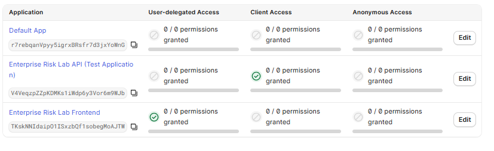

`read:risk` permission defined on the API and granted to the frontend:

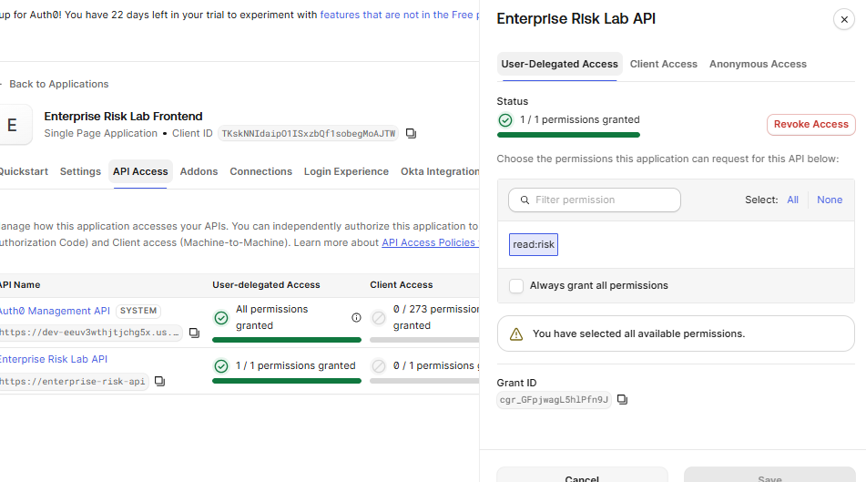

## Backend (local)

Generated with Spring Initializr (Java 21, Maven, Spring Boot 4.1.1) with the Web,
Security, OAuth2 Resource Server, and Actuator starters.

- `SecurityConfig.java`: defines the security filter chain. `/actuator/health` is
  public, `/api/**` requires a valid JWT, everything else is denied by default. CORS
  is restricted to the frontend's dev and production origins.
- `RiskController.java`: exposes `GET /api/risk-status`, the single protected
  endpoint, returning the authenticated user's subject claim.
- `application.properties`: configures the resource server with the Auth0
  `issuer-uri` and `audiences`, so Spring Security both verifies the JWT signature
  (via Auth0's published JWKS) and rejects tokens issued for a different API.

Note: the workshop instructions list only Web, Security, and OAuth2 Resource Server
as dependencies, but reference `/actuator/health` for the local check and later for
the production health check (Part 5). The Actuator starter was added for that
endpoint to exist.

Verified locally:

```
$ curl -i http://localhost:8080/api/risk-status
HTTP/1.1 401

$ curl -i http://localhost:8080/actuator/health
HTTP/1.1 200
{"groups":["liveness","readiness"],"status":"UP"}
```

## Frontend (local)

Built with Vite (React template) and `@auth0/auth0-react`.

- `main.jsx`: wraps the app in `Auth0Provider`, configured from `.env.local`
  (`domain`, `clientId`, `audience` — none of these are secrets for a SPA).
- `App.jsx`: shows a login button when signed out; once signed in, it reads the
  access token with `getAccessTokenSilently()` and calls `GET /api/risk-status`
  with `Authorization: Bearer <token>`. The call is wrapped in `try/catch` and
  checks `response.ok` before parsing the body, so a rejected or expired token
  shows the real HTTP status instead of an unhandled error.

**Deliverable — successful authenticated API call**

Initial state, signed out:

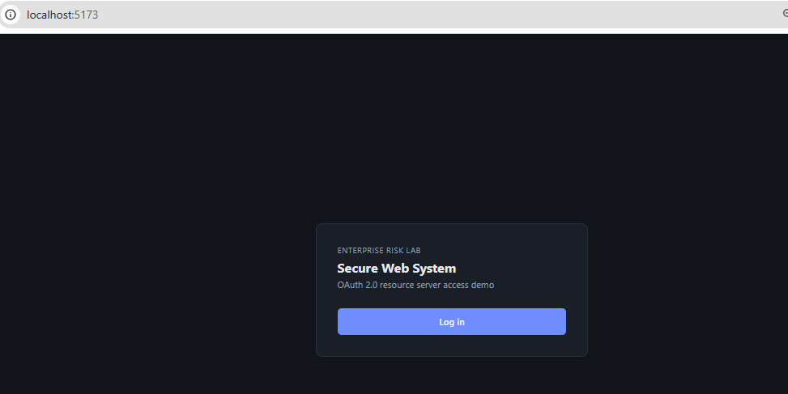

Auth0 Universal Login screen:

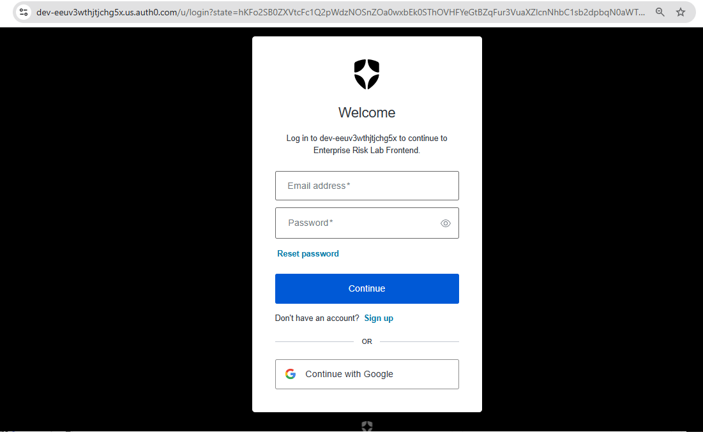

Signed in:

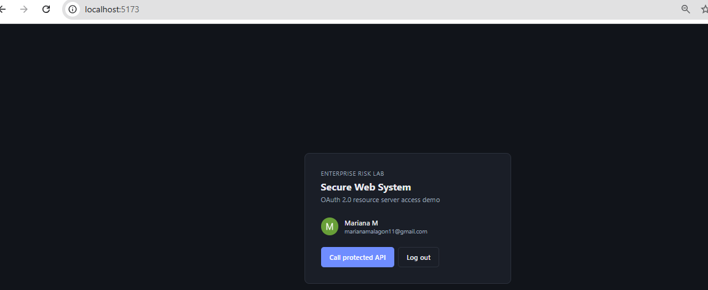

Successful authenticated call to the protected API:

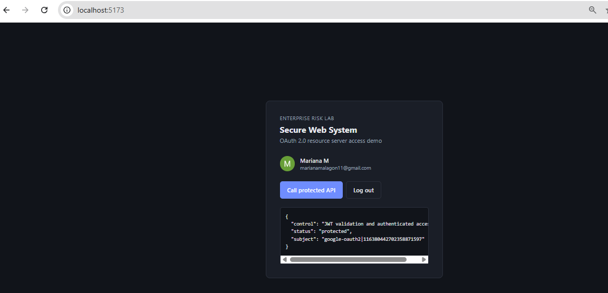

## Server and Duck DNS

- **EC2 instance**: Ubuntu Server 26.04 LTS, `t3.micro`.
  - The workshop instructions assume Ubuntu (`apt`, `apache2`, `a2enmod`/`a2ensite`)
    for Parts 4-6. The instance was first launched from an Amazon Linux AMI by
    mistake (`ec2-user` as the SSH user); it was replaced with an Ubuntu instance to
    match the instructions exactly, reusing the same key pair and security group so
    no network configuration had to be redone.
- **Elastic IP**: `54.173.61.98`, associated with the instance so the public address
  survives stop/start cycles (a plain EC2 public IP changes on every restart).
- **Security group inbound rules**: `22` (SSH, restricted to a single source IP),
  `80` (HTTP), `443` (HTTPS). No rule for `8080` — the backend is never reachable
  from the public internet.
- **Public hostname**: `enterprise-risk-lab-mariana.duckdns.org`, pointed at the
  Elastic IP through Duck DNS. The Duck DNS token is not stored anywhere in this
  repository.
- **Packages installed** (`apt install apache2 certbot python3-certbot-apache
  openjdk-21-jre`): Apache 2.4.66, certbot 4.0.0, OpenJDK 21.0.12.1.
- The network-level firewall is the EC2 security group above (default-deny, only
  80/443/22 open); no additional host firewall was layered on top of it.

Verified: `http://enterprise-risk-lab-mariana.duckdns.org` returns the default
Apache page (`HTTP 200`, `Server: Apache/2.4.66 (Ubuntu)`) — confirms the DNS,
Elastic IP, security group, and Apache installation all work together before any
application-specific configuration (Parts 5-6) is added.

**Evidence**

Security group inbound rules (SSH restricted, HTTP/HTTPS public, no 8080):

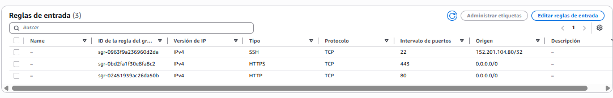

Elastic IP associated with the instance:

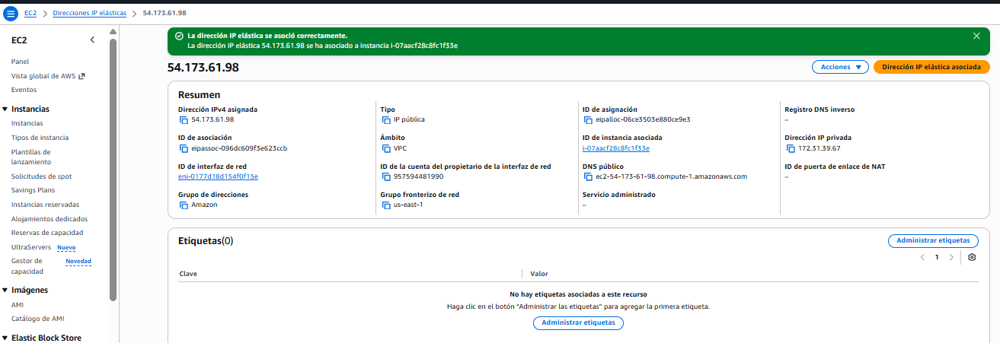

Duck DNS subdomain updated to the Elastic IP:

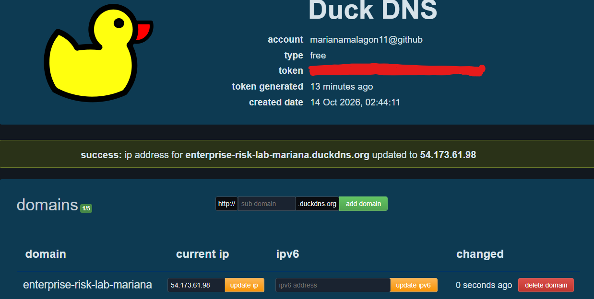

SSH connection details confirming the Ubuntu instance and key pair:

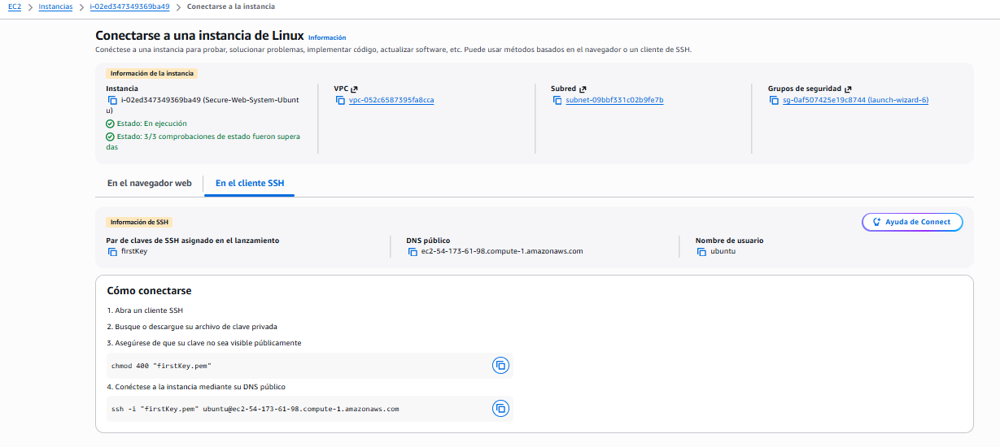

`curl -I` against the public Duck DNS hostname, confirming Apache responds:

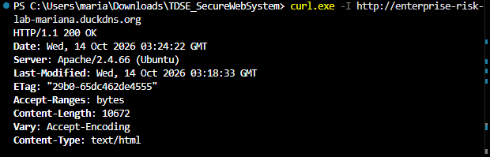

## Backend deployment

- Built locally with `mvn clean package`, copied to the server with `scp` (over the
  already-restricted SSH connection), never built on the server itself.
- Runs under a dedicated, non-login system user (`riskapi`), owning only
  `/opt/enterprise-risk-api`.
- `enterprise-risk-api.service` (kept at
  [`docs/deploy/enterprise-risk-api.service`](docs/deploy/enterprise-risk-api.service)
  for reference, installed at `/etc/systemd/system/`) runs the JAR with
  `Restart=always` and injects the Auth0 issuer/audience as environment variables —
  no secrets, same values as `application.properties`, just overridable without
  rebuilding the JAR. Fixed a missing closing quote and trailing slash in the
  `issuer-uri` present in the workshop's example unit file.
- Managed with `systemctl enable --now`, so it starts automatically on boot.

**Evidence**

SSH connection to the server:

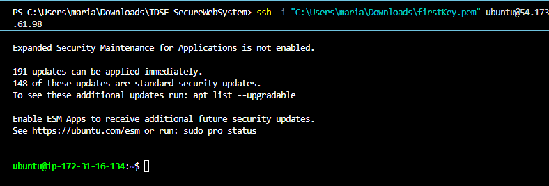

`riskapi` system user and the deployed JAR, owned by it:

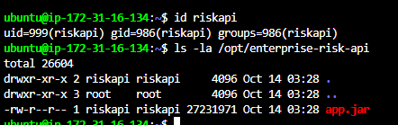

The installed systemd unit:

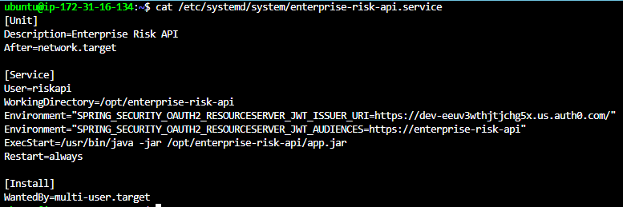

Service active and running:

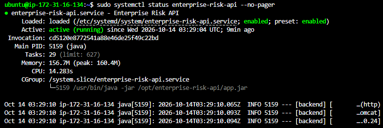

Health check reachable locally on the server:

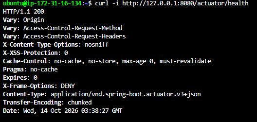

Port 8080 confirmed **not** reachable from the public internet:

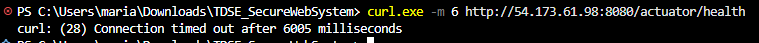

## Apache and HTTPS

- The backend was rebuilt and redeployed with the production origin
  (`https://enterprise-risk-lab-mariana.duckdns.org`) added to
  `SecurityConfig.java`'s CORS configuration, replacing the earlier placeholder.
- The frontend was rebuilt for production with
  `VITE_API_URL=https://enterprise-risk-lab-mariana.duckdns.org` (overriding
  `.env.local` for that one build via a shell environment variable, instead of
  editing the file), then copied to `/var/www/enterprise-risk-frontend`.
- Apache modules enabled: `ssl proxy proxy_http rewrite headers`.
- Virtual host kept at
  [`docs/deploy/enterprise-risk.conf`](docs/deploy/enterprise-risk.conf) (installed
  at `/etc/apache2/sites-available/`): serves the React build as static files,
  falls back to `index.html` for client-side routing, and reverse-proxies `/api/*`
  to the local Spring Boot process.
- Certificate obtained with
  `sudo certbot --apache -d enterprise-risk-lab-mariana.duckdns.org --redirect`,
  which also wrote `enterprise-risk-le-ssl.conf` for port 443 and scheduled
  automatic renewal.
- **Bug found and fixed**: certbot's HTTP→HTTPS redirect rule was added at the
  `VirtualHost` scope, but `RewriteEngine On` was only declared inside the
  `<Directory>` block (for the SPA fallback rule) — in Apache, rewrite engine
  state does not propagate out of a narrower scope, so the redirect never fired
  silently. Fixed by adding `RewriteEngine On` at the `VirtualHost` level too.
- Auth0's Allowed Callback/Logout/Web Origin URLs were updated to include the
  production HTTPS address alongside `http://localhost:5173`.

Verified:

- `http://...duckdns.org` → `301` redirect to `https://...duckdns.org`.
- CORS preflight (`OPTIONS`) from the production origin returns
  `Access-Control-Allow-Origin: https://enterprise-risk-lab-mariana.duckdns.org`.
- `sudo certbot renew --dry-run` → "Congratulations, all simulated renewals
  succeeded."
- Certificate: issued by Let's Encrypt, `CN=enterprise-risk-lab-mariana.duckdns.org`,
  valid until 2027-01-15.

**Deliverable — production login, authenticated API call, and valid certificate**

Logged in on the production URL:

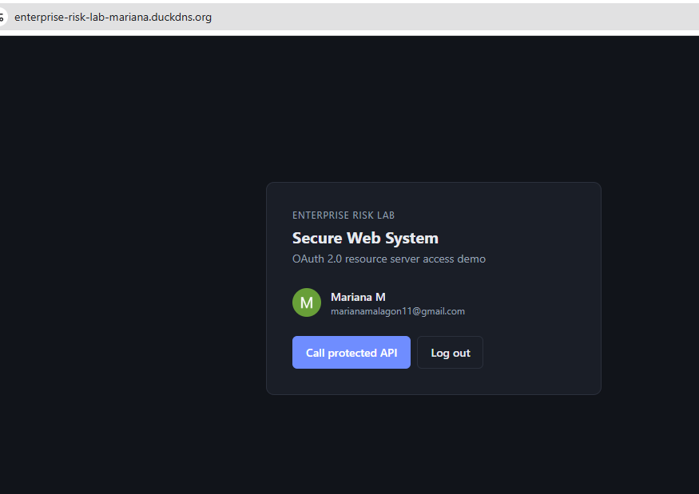

Successful authenticated API call in production:

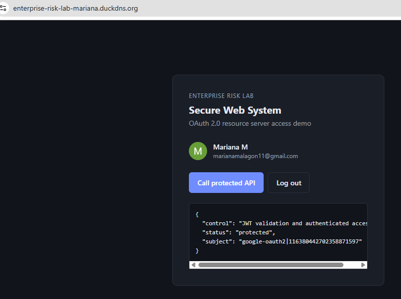

Browser confirming the certificate is valid:

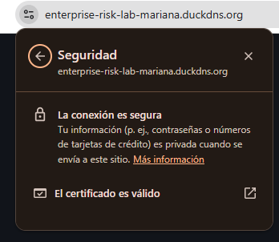

Full certificate chain details (issuer Let's Encrypt, validity period, fingerprints):

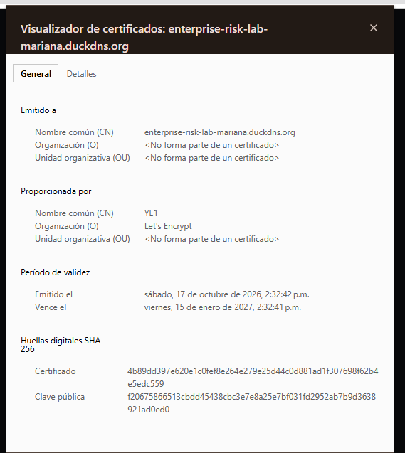

## Verification checklist

- [x] Unauthenticated requests to `/api/risk-status` return `401`. Also verified
  with a malformed/garbage bearer token, confirming the backend validates the JWT
  signature, not just its presence.
- [x] A logged-in user can call `/api/risk-status` from the frontend — see the
  production evidence above.
- [x] The backend validates the JWT issuer and audience (`issuer-uri` and
  `audiences` in `application.properties` / the systemd unit's environment
  variables; confirmed by the `read:risk` permission and `audience`-scoped grant
  working end to end, and by requests being rejected before this was correctly
  wired in Part 1).
- [x] The application is available at
  **https://enterprise-risk-lab-mariana.duckdns.org**.
- [x] The browser shows a valid certificate — see the certificate evidence above.
- [x] Port `8080` is not reachable from the public internet (verified both right
  after deployment in Part 5 and again here in Part 7).
- [x] `sudo certbot renew --dry-run` succeeds — "Congratulations, all simulated
  renewals succeeded."

## Risk-control reflection

| Control | Risk reduced | Evidence |
|---|---|---|
| Auth0 authentication | Impersonation and weak credential handling | Auth0 login flow and user identity ([Part 1](#auth0-configuration), [Part 3](#frontend-local)) |
| JWT validation at the API | Unauthorized API access | `401` without a valid token, and with an invalid one (checklist above) |
| Audience validation | Token reuse against another API | API only accepts tokens issued for `https://enterprise-risk-api`; configured via `spring.security.oauth2.resourceserver.jwt.audiences` |
| HTTPS with a valid certificate | Credential or token exposure in transit | Browser certificate details ([Part 6](#apache-and-https)), HTTP→HTTPS redirect |
| Apache reverse proxy | Direct exposure of the application port | Only ports 80/443 are public; port 8080 confirmed unreachable ([Part 5](#backend-deployment), [Part 7](#verification-checklist)) |
| Central service logs | Delayed incident investigation | `journalctl -u enterprise-risk-api` on the server (systemd captures stdout/stderr automatically) |

`sudo journalctl -u enterprise-risk-api --no-pager -n 20` on the server:

```
Oct 17 20:30:15 ip-172-31-16-134 systemd[1]: Started enterprise-risk-api.service - Enterprise Risk API.
Oct 17 20:30:17 ip-172-31-16-134 java[1346]: ... Starting BackendApplication v0.0.1-SNAPSHOT using Java 21.0.12.1 ...
Oct 17 20:30:19 ip-172-31-16-134 java[1346]: ... Tomcat started on port 8080 (http) with context path '/'
Oct 17 20:30:21 ip-172-31-16-134 java[1346]: ... Started BackendApplication in 5.235 seconds
```

No access tokens, passwords, or other sensitive values appear in these logs —
only startup and framework lifecycle events.

## Repository structure

```
frontend/     React application (added in Part 3)
backend/      Spring Boot application (added in Part 2)
docs/images/  Evidence screenshots gathered throughout the workshop
docs/deploy/  Server configuration files (systemd unit, Apache vhost)
```
